<div align="center">
  
</div>

<p align="center">
  <a href="https://linkedin.com/in/YOUR-LINKEDIN"></a>
  <a href="mailto:YOUR-EMAIL@gmail.com"></a>
  <a href="https://github.com/YOUR-GITHUB-USERNAME?tab=repositories"></a>
</p>

## 01 / about

```yaml
whoami:
  name: Shivansh Pal
  role: Aspiring Software Engineer
  education: YOUR-DEGREE, YOUR-YEAR student
  builds: practical projects, from web apps to ML pipelines
  sharpening: core fundamentals, DSA in Java
  approach: build real things first, then refine the basics behind them
  open_to: [internships, collaborations, project ideas]
```

## 02 / projects

| Project | What it does | Stack |
| --- | --- | --- |
| [project-one](https://github.com/YOUR-GITHUB-USERNAME/project-one) | One line about it | Python |
| [project-two](https://github.com/YOUR-GITHUB-USERNAME/project-two) | One line about it | Java |

## 03 / stack


